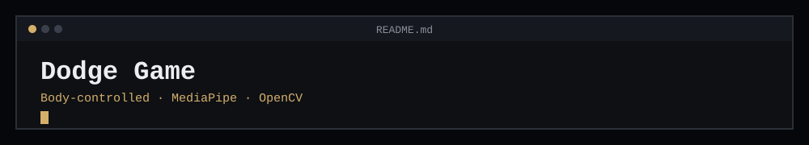

<div align="center">



<br>

<p><i>Dodge falling obstacles using your body. No keyboard needed.</i></p>

<p>
  
  
  
  
</p>

</div>

<br>

---

### How it works

- MediaPipe Pose Landmarker tracks your torso through the webcam
- Your horizontal position moves the on-screen character
- Avoid the falling neon blocks. You have 3 lives, and the difficulty rises over time

### Stack

Python · OpenCV · MediaPipe Tasks API · NumPy

### Run it

```bash
pip install opencv-python mediapipe numpy
python game.py
```

---

<div align="center">
<sub>Built for fun while exploring MediaPipe, OpenCV and NumPy</sub>
</div>
